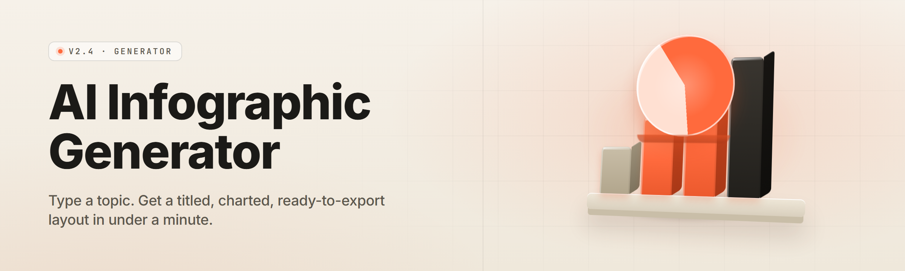

  
  
  

  

  
  
  

---

**Turn a sentence into a finished, print-ready infographic. Offline, on Windows, no design skills, no cloud account.**

---

## 📌 Overview

AI Infographic Studio is a desktop `.exe` that takes a prompt, a CSV, a slide deck, or a rough sketch and lays out a complete infographic — typography, color, charts, iconography, hierarchy, export presets and all. You describe the idea. The layout engine places every element. You nudge what you want. You export PNG, SVG, PDF, or editable layer files, ready for print or web.

| Category | Details |
| --- | --- |
| **Product name** | AI Infographic Studio |
| **Current build** | v2.4.1 (stable desktop release) |
| **Primary function** | Prompt-to-infographic generation + manual layout editor |
| **Engine core** | Local diffusion + layout transformer hybrid |
| **Runtime** | Offline desktop app, `.exe`, Windows 10/11 x64 |
| **GPU acceleration** | CUDA 12 / DirectML / CPU fallback |
| **Export formats** | PNG, SVG, PDF, PPTX, editable `.igs` layer file |
| **License** | MIT (community repo) |

This is a solo-dev release built for people who need one clean graphic by Thursday and don't want to learn Figma, hire a designer, or upload their company's numbers to a stranger's server. Everything runs locally. Your data never leaves the machine.

---

## 🧩 Grouped Module Catalog

The app ships as a set of independent modules that talk to a shared layout bus. Every module below is a real, loadable component in the desktop build.

### 🧠 Generation Core

- **Prompt Interpreter** — parses a plain-English brief into a structured layout intent (audience, tone, density, hierarchy).
- **Layout Transformer** — arranges blocks on a responsive grid using learned spacing and alignment priors.
- **Palette Synthesizer** — derives a cohesive color system from a mood word, a brand hex, or an uploaded logo.
- **Type Pairing Engine** — selects a heading/body font pair from 240 bundled faces, matched to tone.
- **Icon Matcher** — assigns vector icons to data points from a 9,000-glyph offline library.
- **Chart Selector** — chooses bar, donut, radar, or treemap based on data shape and message.

### 📊 Data & Content Modules

- **CSV/TSV Ingest** — maps columns to chart roles with automatic type detection.
- **JSON Schema Binding** — binds live datasets to chart layers via a visual mapper.
- **Slide Deck Import** — reads `.pptx` outlines and rebuilds them as infographic sections.
- **Markdown Outline Parser** — turns heading trees into hierarchical panels.
- **Fact-Check Strip** — flags numeric claims that lack a source tag before export.
- **Text Condenser** — shortens long copy to headline + subhead density without losing meaning.

### 🎨 Layout & Editing Modules

- **Smart Grid Snapper** — magnetically aligns elements to a 12-column responsive grid.
- **Auto-Balance Rewriter** — reflows a section when you drag one block out of place.
- **Layer Inspector** — tree view of every element, group, and mask.
- **Constraint Painter** — pins relationships (left-of, above, equal-width) between blocks.
- **Shadow & Depth Kit** — 18 non-cheesy elevation presets tuned for flat design.
- **Bleed & Trim Tool** — visual guides for print-safe margins and cut zones.

### 🖼️ Rendering & Export Modules

- **Vector Rasterizer** — clean high-DPI PNG output up to 12000px.
- **SVG Layered Export** — every element stays an editable vector group.
- **PDF Print Pipeline** — CMYK conversion, ICC profile embed, bleed marks.
- **PPTX Handoff** — exports editable slides for clients who live in PowerPoint.
- **Batch Exporter** — renders 50 variants from a CSV of prompts in one run.
- **Watermark Engine** — optional, removable, for draft review rounds.

### 🧰 Utility & Workflow Modules

- **Prompt History Sidebar** — every generation saved and re-runnable locally.
- **Brand Kit Manager** — store logos, fonts, and palettes per client project.
- **Template Library** — 320 starter layouts across 14 industry categories.
- **Version Snapshots** — local undo tree with named checkpoints.
- **Offline Asset Cache** — icons, fonts, and patterns pre-loaded at first launch.
- **Auto-Updater** — background check for new builds, manual-apply only.

---

## 📖 What is AI Infographic Studio?

| Term | Explanation |
| --- | --- |
| **Infographic** | A single visual that combines text, data, and imagery to communicate one idea fast. |
| **Layout bus** | The internal data channel every module reads from and writes to, keeping the design consistent. |
| **Prompt interpreter** | The module that converts your plain-English brief into structured layout parameters. |
| **Brand kit** | A saved bundle of logo, fonts, and palette tied to one project or client. |
| **Layer file (`.igs`)** | The app's editable source format — reopen it anytime to keep editing. |
| **Bleed** | Extra print area beyond the trim line so background color survives cutting. |

Why people reach for it:

- **No design degree required.** Type a brief, get a structured draft in seconds.
- **Local and offline.** Nothing is uploaded; your data stays on your machine.
- **Real editable output.** Every export is layered, not a flattened screenshot.
- **Print-ready when you need it.** CMYK, bleed, and ICC profiles are built in.
- **Cheap at scale.** Batch mode renders dozens of variants without a subscription.

---

## ⭐ Key Features

| Feature | Description | Benefit |
| --- | --- | --- |
| Prompt-to-layout | Converts a sentence into a full grid-arranged infographic draft. | Skip the blank canvas entirely. |
| Live data binding | Charts update as the CSV changes, no re-export loop. | Data stays current with one refresh. |
| Brand kit memory | Saves logo, fonts, and palette per client. | Every project matches house style. |
| Vector-native editing | Elements stay editable after export to SVG. | Designers can refine downstream. |
| Print pipeline | Built-in CMYK + bleed + trim marks. | No second trip to a print tool. |
| Batch rendering | 50 variants from one CSV run. | Scale content without manual redraws. |
| Offline icon library | 9,000 bundled vector glyphs. | No license hunting mid-project. |
| Constraint painting | Pin element relationships, not pixel positions. | Layouts survive content swaps. |

  

---

## 🚀 Quick Start

1. 🗂️ **Visit the project page** and grab the latest desktop build from the landing page.
2. 📦 **Extract** the downloaded archive to any folder — no installer wizard required.
3. 🖱️ **Run** the app `.exe` from the extracted folder (Windows may ask you to allow it once).
4. ✍️ **Type a brief** like *"3-panel infographic on solar adoption, blue tones, clean."*
5. 🎯 **Edit and export** — nudge what you like, then export PNG, SVG, or PDF.

---

## 🔄 Comparison

| Aspect | Generic Design Tools | Cloud AI Design Bots | This Tool |
| --- | --- | --- | --- |
| Runs offline | Partly | No | **Yes, fully** |
| Prompt-to-layout | No | Yes, server-side | **Yes, local** |
| Data upload privacy | Manual | Sent to servers | **Stays local** |
| Editable vector export | Native | Flattened PNG usually | **Layered SVG/PDF** |
| Batch generation | Manual | Paid tiers only | **Built in** |
| Print-ready pipeline | Add-on | No | **Built in** |
| Cost model | Subscription | Per-seat cloud | **One download, MIT** |
| Custom brand kits | Manual | Limited | **Per-project memory** |

---

## 🖥️ Compatibility / Platform Support

| Platform | Minimum | Recommended | Status |
| --- | --- | --- | --- |
| Windows 10 x64 | 8 GB RAM, GTX 1050 | 16 GB RAM, RTX 3060 | ✅ Supported |
| Windows 11 x64 | 8 GB RAM, DirectML GPU | 16 GB RAM, RTX 4060 | ✅ Supported |
| Windows 11 ARM | 16 GB RAM | 16 GB RAM, Snapdragon X | ⚠️ Experimental |
| macOS (via Wine) | Not tested | — | ⛔ Unsupported |
| Linux (via Proton) | Not tested | — | ⛔ Unsupported |

---

## 🛠️ Installation

1. **Download the archive** from the project landing page (see the 

  

 marker above the Quick Start section).
2. **Extract** it to a folder of your choice — the app is portable and does not write to the registry until you first launch it.
3. **Run the `.exe`** from the extracted folder. On first launch the app caches bundled fonts, icons, and templates to a local data folder. This can take up to 60 seconds on a spinning disk.

> If SmartScreen warns about an unrecognized publisher, choose *More info → Run anyway*. This is a solo-dev release, not a signed enterprise binary.

---

## 🧱 The Solution

| Problem | Solution |
| --- | --- |
| Blank canvas paralysis | Prompt interpreter produces a structured draft in seconds. |
| Cloud tools upload your data | Fully offline generation, nothing leaves the machine. |
| Designers cost time and money | Template + layout engine replaces the first 80% of the work. |
| Exported PNGs can't be edited | Vector-layered SVG and PDF remain editable downstream. |
| Rebuilding charts for new data is slow | Live data binding refreshes charts from the CSV directly. |
| Print jobs come back wrong | Built-in bleed, trim, and CMYK conversion. |
| Scaling content means redrawing | Batch exporter renders 50 variants from one CSV. |

---

## 📋 All Modules Status

| Module | Status | Description |
| --- | --- | --- |
| Prompt Interpreter | ✅ Working | Parses briefs into structured layout intents. |
| Layout Transformer | ✅ Working | Arranges blocks on a responsive grid. |
| Palette Synthesizer | ✅ Working | Derives color system from mood or brand hex. |
| Type Pairing Engine | ✅ Working | Matches heading/body font pairs from 240 faces. |
| Icon Matcher | ✅ Working | Assigns icons from 9,000-glyph library. |
| Chart Selector | ✅ Working | Picks chart type from data shape and message. |
| CSV/TSV Ingest | ✅ Working | Maps columns to chart roles automatically. |
| JSON Schema Binding | ✅ Working | Binds live datasets via visual mapper. |
| Slide Deck Import | ✅ Working | Rebuilds `.pptx` outlines as sections. |
| Markdown Outline Parser | ✅ Working | Turns heading trees into panel hierarchies. |
| Fact-Check Strip | ✅ Working | Flags unsourced numeric claims. |
| Text Condenser | ✅ Working | Shortens copy to headline density. |
| Smart Grid Snapper | ✅ Working | Magnetic alignment to 12-column grid. |
| Auto-Balance Rewriter | ✅ Working | Reflows sections on drag. |
| Layer Inspector | ✅ Working | Tree view of elements, groups, masks. |
| Constraint Painter | ✅ Working | Pins element relationships. |
| Shadow & Depth Kit | ✅ Working | 18 elevation presets for flat design. |
| Bleed & Trim Tool | ✅ Working | Visual print-safe margin guides. |
| Vector Rasterizer | ✅ Working | High-DPI PNG up to 12000px. |
| SVG Layered Export | ✅ Working | Every element stays editable. |
| PDF Print Pipeline | ✅ Working | CMYK + ICC + bleed marks. |
| PPTX Handoff | ✅ Working | Editable slides for client handoff. |
| Batch Exporter | ✅ Working | 50 variants from one CSV run. |
| Watermark Engine | ⚠️ Beta | Optional, removable draft watermark. |
| Prompt History Sidebar | ✅ Working | Local, re-runnable generation history. |
| Brand Kit Manager | ✅ Working | Per-client logo, font, palette storage. |
| Template Library | ✅ Working | 320 layouts across 14 categories. |
| Version Snapshots | ✅ Working | Named checkpoints in undo tree. |
| Offline Asset Cache | ✅ Working | Pre-loaded fonts, icons, patterns. |
| Auto-Updater | ⚠️ Beta | Background check, manual-apply only. |

---

## 📐 Usage Guidelines

| Allowed | Not allowed |
| --- | --- |
| Commercial client work | Reselling the app or its asset library as your own |
| Modifying and redistributing the source | Removing the MIT attribution notice |
| Educational and hobbyist use | Claiming authorship of bundled third-party fonts |
| Selling the infographics you generate | Rebranding the bundled icon library as proprietary |

---

## 🩹 Known Issues

| Issue | Fix |
| --- | --- |
| First launch takes >60s on HDD | Expected — asset cache warms once. Subsequent launches are instant. |
| SmartScreen warns on launch | Choose *More info → Run anyway*; binary is unsigned. |
| CUDA not detected on RTX 40-series | Update to the latest NVIDIA driver, then relaunch the app. |
| PDF export shifts colors on cheap printers | Switch to the bundled "Generic CMYK" ICC profile in export settings. |
| Batch exporter stalls above 50 variants | Split the CSV into two runs; memory cap is ~1.8 GB per batch. |

---

## ❓ FAQ

**1. Do I need an internet connection to use this?**
No. The app runs fully offline after the first launch. All generation, layout, and export happen on your machine. The only time it touches the network is an optional update check you can disable.

**2. Where does the app store my files and brand kits?**
Everything lives in a local data folder inside the extracted directory tree. Nothing is written to a remote server, and no telemetry is collected.

**3. Can I edit the exported SVG in another tool?**
Yes. Every element stays a vector group with a stable ID, so you can open the SVG in any vector editor and keep working on it without redoing the layout.

**4. Is there a monthly subscription or license key?**
No. The app is MIT-licensed. Download it, run it, and use it as much as you want.

**5. What if my GPU is too old?**
The app falls back to CPU generation automatically. Drafts take longer but the output quality is identical.

**6. Will my print shop accept the PDF export?**
Yes, as long as you export with bleed and trim marks enabled. The bundled ICC profiles cover the common offset and digital print workflows.

**7. Can I run it from a USB drive?**
Yes. The whole app is portable — as long as the extracted folder moves with the drive, it works.

**8. Does it support non-Latin fonts for the infographics?**
Yes. The bundled library includes Cyrillic, CJK, and Arabic-capable faces. Install additional fonts system-wide for anything else.

---

## 📝 Short Changelog

- **v2.4.1** — Constraint Painter stability fix, faster asset cache warm-up.
- **v2.4.0** — Batch exporter added, PDF CMYK pipeline rewritten.
- **v2.3.2** — Icon library expanded to 9,000 glyphs.
- **v2.3.0** — Brand Kit Manager and Version Snapshots added.

---

## 🎯 Closing

The point of AI Infographic Studio is simple: turn a sentence into a finished, editable, print-ready graphic without leaving the machine and without giving up control of the output. Every module in the catalog above is real, documented, and loadable in the desktop build. If you build something with it — a report, a poster, a client deck — that's the whole reason it exists. Say what you want to make, and make it.

  

